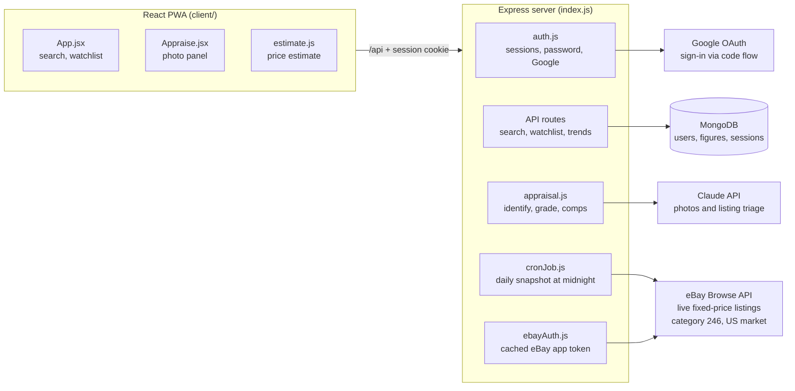

# Wrestling Figure Tracker architecture

As of Nov 20, 2026

## Summary

The app has two parts. One Express server holds the API, sign-in, a daily eBay price job and the Claude photo appraisal. A React + Vite progressive web app in `client/` talks to it over `/api`. MongoDB stores users, sessions and tracked figures, eBay's Browse API supplies every price, and Claude identifies and grades figures from photos.

This describes the `main` branch up to the commit "Enable user logins, including Google auth". It covers the code as written, not a running deployment.

## How the parts fit

The browser only talks to the server. Each arrow shows a module's main dependency; in practice the API routes, appraisal and cron all search eBay with the token from `ebayAuth.js`, and auth and cron also read and write MongoDB. In production, Express also serves the built client from `client/dist`.

## Tech stack

| Layer | Technology | Used for |
| --- | --- | --- |
| Server | Node.js (ES modules), Express 5 | API, auth, static hosting in production |
| Database | MongoDB via Mongoose 9 | Users, tracked figures, price snapshots |
| Sessions | express-session + connect-mongo | Login cookie `wrestling.sid`, sessions stored in Mongo, 30 days |
| Auth | bcryptjs, Google OAuth 2.0 | Email/password and Google sign-in |
| Scheduling | node-cron | Daily price snapshot at midnight |
| AI | `@anthropic-ai/sdk` + zod | Photo identification, grading, listing triage with structured output |
| Prices | eBay Browse API (client-credentials token) | Live fixed-price listings, category 246 |
| Client | React 19, Vite 8 | Single-page app |
| Charts | Recharts | Price trend charts |
| PWA | vite-plugin-pwa (Workbox) | Installable app; `/api` is never cached |
| Lint | oxlint | Client linting |

There is no TypeScript, no test suite (`npm test` is a placeholder) and no CI or deploy configuration in the repo.

## Directory layout and main modules

Server files sit at the repo root; the client is a separate npm package in `client/`.

| Path | Role |
| --- | --- |
| `index.js` | Entry point. Middleware, sessions, all non-auth routes, starts the DB connection and the cron job, serves `client/dist` in production |
| `auth.js` | Register, login, logout, `/me`, Google OAuth. `requireUser` guards every `/api` route except `/api/auth/*` |
| `db.js` | Mongoose connection from `MONGO_URL`; exits the process on failure |
| `ebayAuth.js` | Picks sandbox or production from `EBAY_ENV`, rejects mismatched keys, caches the app token |
| `ebaySearch.js` | eBay condition IDs and the search filter (fixed-price only) |
| `cronJob.js` | `snapshotFigure()` and the daily job that snapshots every tracked figure |
| `utils/priceCalculator.js` | Min, max, average and median from a list of listings |
| `appraisal.js` | Photo pipeline: identify and grade with Claude, then search eBay and have Claude judge each listing |
| `models/User.js`, `models/TrackedFigure.js` | Mongoose schemas |
| `testEbay.js` | Manual script that checks eBay credentials and search |
| `handoff.md`, `docs/usage.txt` | Design notes for photo appraisal; local run commands |
| `client/src/main.jsx` | React root, registers the service worker |
| `client/src/App.jsx` | Main UI: sign-in, search, watchlist, trend charts, theme |
| `client/src/Appraise.jsx` | Add Figure panel: photo upload, candidates, grade, comps |
| `client/src/estimate.js` | Price estimate from judged listings, computed in the browser |
| `client/vite.config.js` | PWA manifest, Workbox rules, dev proxy `/api` to port 5001 |

## Data model and storage

Two Mongo collections hold the data, and each figure's price history lives inside the figure's own document.

| Model | Fields | Notes |
| --- | --- | --- |
| `User` | email (unique, lowercased), passwordHash (optional), googleId (unique, sparse), name, timestamps | A user can have a password, a Google ID or both |
| `TrackedFigure` | user (ref to User, indexed), name, brand (default Mattel), series, searchKeywords, condition, snapshots[], timestamps | condition is an eBay condition ID: ALL, 1000, 1500, 3000, 4000, 5000 or 6000 |
| Snapshot (embedded) | date, listingCount, minPrice, maxPrice, avgPrice, medianPrice | At most one per UTC day; a second run that day overwrites it |
| Sessions | managed by connect-mongo | 30-day cookie, httpOnly, sameSite lax, secure in production |

The first person to sign in claims every figure that has no owner, but only while no figure has an owner yet. That is how data from before logins existed moves to the first account.

Appraisal photos and results are not stored. Photos go to the Claude API and are discarded.

## Request flows

Every `/api` route except `/api/auth/*` returns 401 without a session, and every figure query is filtered by the signed-in user.

| Endpoint | What happens |
| --- | --- |
| `POST /api/auth/register`, `/login` | Validates email and password (8+ characters), hashes with bcrypt (cost 12), starts a session |
| `GET /api/auth/google` → `/google/callback` | OAuth code flow with a state check; links an existing account by email or creates one |
| `GET /api/auth/me`, `POST /logout` | Returns the current user; destroys the session |
| `GET /api/figures/search` | Searches eBay (brand + query, condition filter, fixed price) and returns the top 20 listings |
| `GET /api/tracked-figures` | The user's watchlist, newest first |
| `POST /api/tracked-figures` | Saves a figure, then takes its first price snapshot right away |
| `GET /api/tracked-figures/:id/trends?days=30` | Snapshot history in the window, shaped for Recharts |
| `GET /api/appraisals/status` | Whether a Claude key is set and whether eBay is flagged as mocked |
| `POST /api/appraisals/identify` | Claude (high effort) returns ranked candidates, stamp text, a C1–C10 grade, flaws, quick questions and photo requests |
| `POST /api/appraisals/price` | Searches eBay for the chosen candidate (widens the search under 10 hits); Claude (low effort) labels each listing's match and packaging |

The daily job runs at midnight server time. It loops over every tracked figure for all users, searches eBay (up to 50 listings) and saves the day's min, max, average and median.

The appraisal estimate is computed in the browser by `estimate.js`. It uses same-figure listings in the same packaging, takes the 25th–75th percentile as the range and places the estimate within it by grade, so changing packaging or grade updates the price with no new request.

## Build, run and deploy

Locally it runs as two processes; in production it is one Node process serving both the API and the built client.

1. **Local dev:** start MongoDB (`brew services start mongodb-community`), copy `.env.example` to `.env`, then `npm run dev`. That runs the server and Vite together; Vite serves on port 5173 and proxies `/api` to port 5001.
2. **Build:** `npm run build` installs the client's packages and writes `client/dist`.
3. **Production:** `NODE_ENV=production npm start`. Express serves `client/dist` with an SPA fallback, trusts one proxy hop and sets secure cookies. Google's redirect URI follows the request host.

| Variable | Required | Purpose |
| --- | --- | --- |
| `SESSION_SECRET` | Yes, the server won't start without it | Signs the session cookie |
| `MONGO_URL` | Yes | Database and session store |
| `EBAY_ENV` | No, defaults to sandbox | sandbox or production |
| `EBAY_SANDBOX_*` / `EBAY_PRODUCTION_*` client ID and secret | Yes, for the chosen environment | eBay app token |
| `PORT` | No, defaults to 5000 | Must be 5001 in dev to match the Vite proxy |
| `GOOGLE_CLIENT_ID`, `GOOGLE_CLIENT_SECRET` | No | Google sign-in |
| `ANTHROPIC_API_KEY` | No | Photo appraisal |
| `CLIENT_ORIGIN` | No | Where dev Google sign-in returns to (default localhost:5173) |

The repo names no hosting provider and has no Dockerfile or CI workflow.

## Observations and gaps

None of these break the app today, but each is worth knowing before the next change.

- **Mock flag only changes a label.** `EBAY_MOCK=1` makes the UI say eBay is mocked, but no mock code exists.
- **Midnight mismatch.** The cron runs at the server's local midnight, while snapshots are keyed by UTC day.
- **Port default.** The server defaults to 5000 but the dev proxy expects 5001, so `.env` must set `PORT=5001`.
- **eBay search is written three times.** `index.js`, `cronJob.js` and `appraisal.js` each build the same Browse API request.
- **Asking prices only.** The Browse API returns active listings, not sold prices (noted in `handoff.md`).
- **No tests or CI.** `testEbay.js` is a manual connectivity check, not a test suite.
